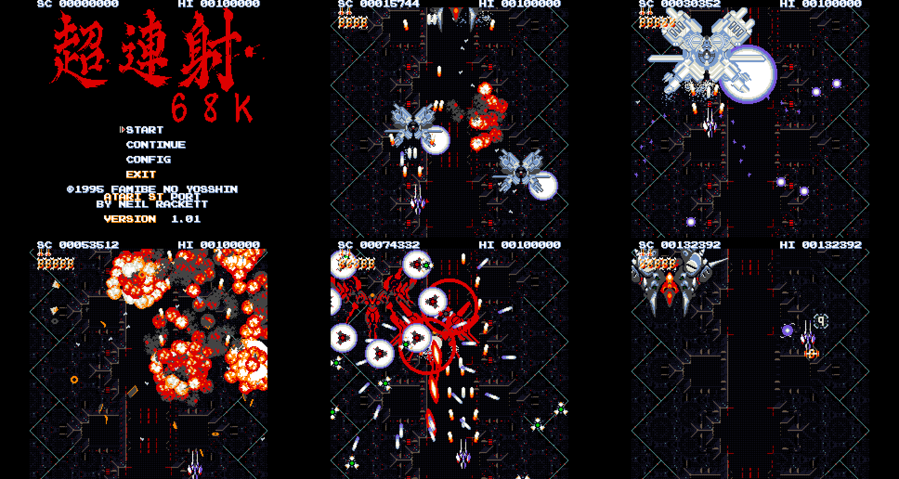

# Cho Ren Sha 68k for Atari ST



Famibe No Yosshin's [Cho Ren Sha 68k (超連射 68k)](https://yosshin4004.github.io/x68k/crs68k/official/index.html),
ported to the Atari ST by [Neil Rackett](https://neilrackett.com/atarist).

## Introduction

[Cho Ren Sha 68k](https://yosshin4004.github.io/x68k/crs68k/official/index.html)
is a vertical shoot 'em up for the Sharp X68000, (c) 1995 by Famibe No
Yosshin.

The Atari ST version builds on Sascha Springer's Atari Falcon port and Adam
Polkosnik's [Amiga port](https://github.com/apolkosnik/chorensha), with the
X68000 program running on the ST's own 68000, drawing the X68000's sprites,
background and text in ST low resolution using 16 colours.

The whole game plays at its full speed, with its music, the original songs
reduced to the YM2149's three voices, and its sound effects (DMA sound on an
STE or Mega STE; on an ST the YM2149 plays them too, on one of its voices).

The screenshots above are all from the ST port running in full height
overscan mode (`screen=full`, see Configuration), taken at the same moment in
the demo as the Amiga screenshots in `docs/screenshots/amiga`, in case you
want to compare.

You can always download the latest build from the
[release page](https://github.com/neilrackett/atarist-chorensha/releases/latest).

## Requirements

- An Atari ST, STE or Mega STE with a colour monitor: the game runs in low
  resolution at 50Hz. No BLiTTER is needed.
- 4MB RAM: an STE or Mega STE needs about 3.1MB of it free, an ST (which
  loads no samples) about 2.7MB. What is left over is the sprite cache:
  more means faster.
- A hard disk with 2.2MB free.
- TOS 1.04 or above.
- Sound effects are the original samples on an STE or Mega STE, YM2149
  versions of them (made from the samples) on a regular ST. The music is
  the YM2149's on all three.
- An Xpad provider if you'd like to play with a gamepad (see Controls).

Speed: the game itself always runs at full speed (50fps); how many of those
frames are rendered depends on the machine. An ST or STE shows about 12 per
second and a Mega STE up to 25 (switched to 16MHz with cache automatically);
with the score in a band of its own (`hud=band`, see Configuration) about 6%
more.
At full height (see Configuration) you lose about 20% of the framerate,
but gain 20% more screen.

## Installing

1. Download `ChoRenSha-atarist.zip` from the [release page](https://github.com/neilrackett/atarist-chorensha/releases/latest).
2. Extract the `CHORENSH` folder to your ST's hard disk.
3. Run `SZ2.TOS`.

## Controls

| Key                   | Joystick   | Gamepad                         | Action                                                                           |
| --------------------- | ---------- | ------------------------------- | -------------------------------------------------------------------------------- |
| Arrow keys            | Directions | D-pad / left stick              | move                                                                             |
| Ctrl / Z              | Fire       | A, X, right shoulder or trigger | shoot                                                                            |
| Return / Enter        |            |                                 | choose in the menus (as fire, which it is in a game too)                         |
| Shift / X             |            | B, Y, left shoulder or trigger  | second button                                                                    |
| P                     |            | Start                           | pause (press again to continue)                                                  |
| Esc                   |            |                                 | back to the title (from a game, also paused or at game over, and from CONFIG or the hidden menu); on the title: quit |
| F1                    |            |                                 | lockstep on / off: every frame is shown, the game slowed to the drawing speed    |
| F2                    |            |                                 | keep the playfield window still instead of following the ship                    |
| 1, Tab, Space         |            |                                 | as the same keys on the X68000                                                   |

A joystick works in either port. On an STE, a Jaguar pad in the enhanced
joystick port A works too: A shoots and B is the second button.

Gamepads are supported via [Xpad](https://neilrackett.com/atarist/atarist-xpad)
providers (MD/Sidepad, COMpad, STEpad or any other); the start-up text says
when a provider was found.

**Auto fire:** holding the shot button keeps shooting (the original game
shot once per press).

**Hidden menu:** hold Shift (or X, or B on a pad) and choose CONFIG with
fire for the original game's hidden menu, KAKUSI mode. MUTEKI makes the
ship invincible (left or right switches it on and off), STAGE picks the
stage to start at, BOSS_ONLY plays the bosses alone, and EXIT (or Esc) goes
back to the title. Its settings last until the program ends. The original's own
way works too: up, down and right at once (an X68000 pad's SELECT and
right) as CONFIG is chosen.

## Configuration

Settings go in `SZ2.CFG`, next to `SZ2.TOS`: one `name=value` a line, in any
case, with `#` or `;` starting a comment. The `SZ2.CFG` in the download lists
them all, commented out, each set to the opposite of its default. Without the
file every setting has its default; a setting the program does not know, or a
value it cannot read, is named on the start-up screen and ignored.

| Setting           | Default | Meaning                                                                                                                                                 |
| ----------------- | ------- | ------------------------------------------------------------------------------------------------------------------------------------------------------- |
| `preset`          | `default` | `default`: the other settings as you set them. `performance` (crop, `hud=band`, no music: the most pictures per second) and `authentic` (full height, the score over the playfield, music: as close to the X68000 as it gets) set `screen`, `hud`, `megaste_speedup` and `music` together, whatever the file says |
| `screen`          | `crop`  | `crop`: the 200-line screen, 200 of the playfield's 256 lines in a window that follows the ship. `full`: both borders open, 273 lines and the whole picture |
| `hud`             | `over`  | `over`: the score over the top of the playfield, as on the X68000. `band`: in a black band of its own, 8 lines fewer of playfield, about 6% more pictures per second |
| `megaste_speedup` | `true`  | `false`: a Mega STE stays at 8MHz without its cache (for testing)                                                                                       |
| `music`           | `true`  | `false`: no music                                                                                                                                       |
| `lockstep`        | `false` | `true`: every frame drawn from the start (F1 switches it)                                                                                               |
| `frames`          | `0`     | For testing: the attract demo runs for that many frames, then the program reports the pictures it drew and exits. 0: never                              |

If the borders do not open on a machine, `screen=full` falls back to crop.

### Feedback

Please [submit an issue](https://github.com/neilrackett/atarist-chorensha/issues)
or [open a pull request](https://github.com/neilrackett/atarist-chorensha/pulls)
if you find anything that doesn't work or if you'd like to contribute to make
it better.

Please include as much information as possible, including:

- The Atari ST model and TOS version (ST, STE, Mega ST, Mega STE)
- Whether you are using an emulator (e.g. [Hatari](https://www.hatari-emu.org/)) or real hardware
- The amount of RAM you have installed
- Any devices you have connected (hard disk interface, cartridges, Xpad provider)
- Your `SZ2.CFG` settings
- The exact steps to reproduce the issue
- The text the program shows at start-up and exit

## Building

With [atarist-toolkit-docker](https://github.com/sidecartridge/atarist-toolkit-docker)
installed (and Docker running):

```
git submodule update --init
make
```

This produces `binaries/st/SZ2.TOS` and `dist/CHORENSH`, the folder to copy
to an ST:

```
CHORENSH/
  SZ2.TOS                the program (320 KB)
  SZ2.CFG                its settings (see Configuration)
  BGM_DAT/               the original MCDRV song data (loaded, not played)
  ETC_DAT/               demo replays, tables, high scores
  MUS_DAT/               the songs as YM2149 register streams
  PCM_DAT/               the sound effects: the samples, and SZ2_YM.BIN,
                         their YM2149 versions for an ST
  XSP_DAT/               the sprites
```

`binaries/st` holds the same data, so the program also runs from there.
`make debug` builds the measurement version, `make test` runs the tests in
Hatari, and `make clean` removes what the builds and tests made. The other
make targets, running the game in Hatari and on a real ST, how the songs in
`MUS_DAT` are made, and how the port works:
[docs/ST_PORT.md](docs/ST_PORT.md).

## Credits

- [Original game](https://yosshin4004.github.io/x68k/crs68k/official/index.html):
  (c) 1995 Famibe No Yosshin (X68000), sound (c) 1995, 1998 by Loser Kashiwagi.
- Atari Falcon port and the disassembly this port builds on: Sascha
  Springer.
- [Amiga port](https://github.com/apolkosnik/chorensha): Adam Polkosnik.
- Amiga colour icons: Hexaae.
- The music recorded with MCDRV 0.69 by CUL (free software), played by the
  Musashi 68000 emulator: rendered with ymfm's YM2151 (Aaron Giles) for the
  Amiga port, reduced to the YM2149 with STDL's `stdlconv opm` for the
  Atari ST port.
- Atari ST port: [Neil Rackett](https://neilrackett.com/atarist)
- Full-height overscan on the Atari ST via
  [STDL](https://github.com/neilrackett/atarist-stdl), LGPL-2.1. See
  `lib/stdl/LICENSE`.
- Controller input on the Atari ST via Xpad, Copyright (c) 2026 Neil
  Rackett, BSD-2-Clause. See `lib/xpad/LICENSE`.

## More info

- The original game's [official page](https://yosshin4004.github.io/x68k/crs68k/official/index.html):
  version 1.10 for the X68000, and a Windows build. This port, like the
  Falcon and Amiga ones, is built from version 1.01.
- The Atari ST port's technical notes: [docs/ST_PORT.md](docs/ST_PORT.md).
- The Amiga port, upstream: [apolkosnik/chorensha](https://github.com/apolkosnik/chorensha),
  and its notes in [docs/AMIGA_PORT.md](docs/AMIGA_PORT.md).
