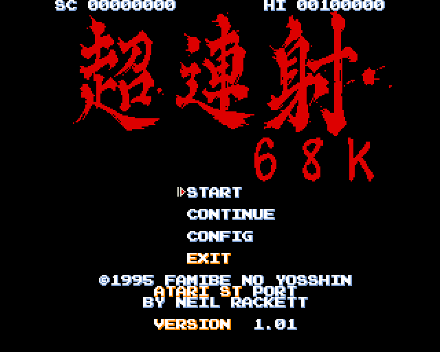
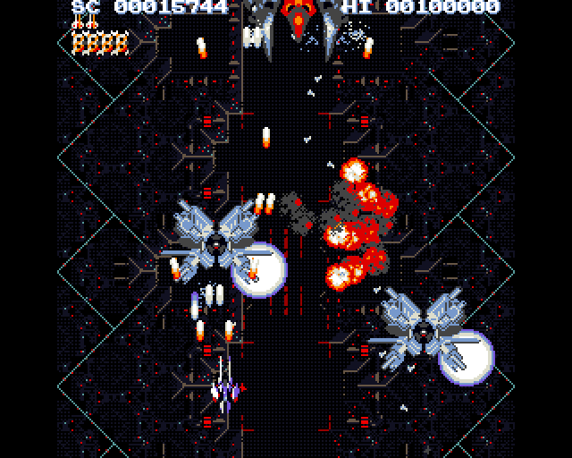
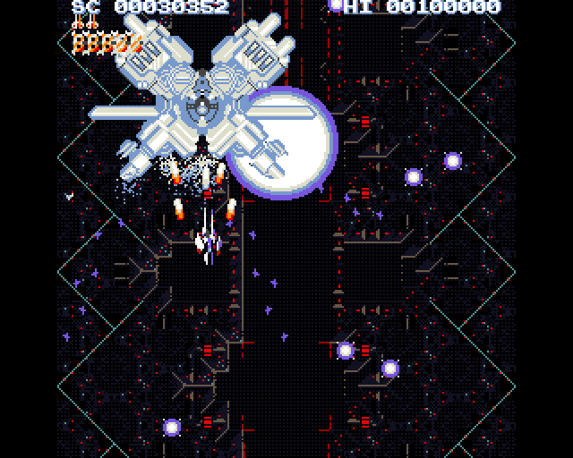
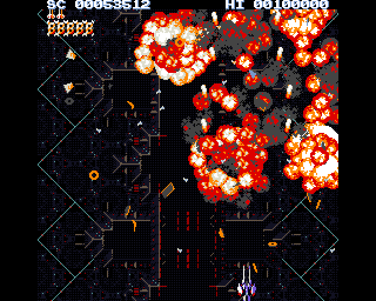
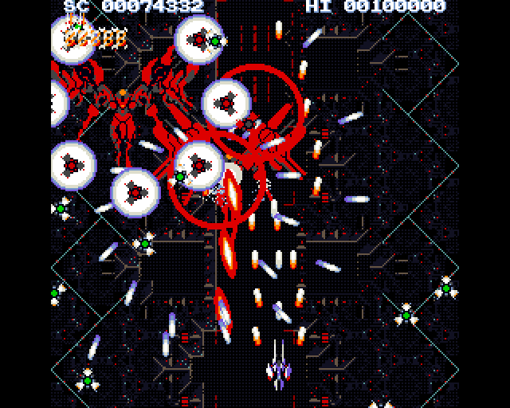
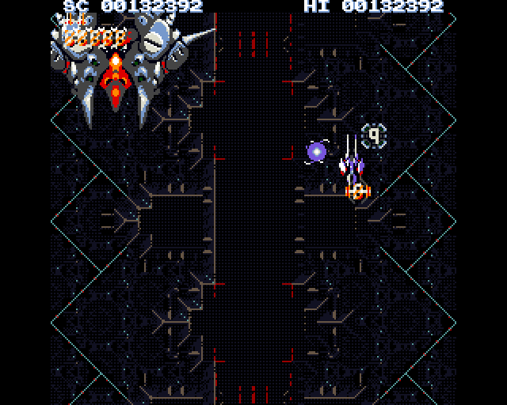

# Cho Ren Sha 68k - Atari ST

Cho Ren Sha 68k is a vertical shoot 'em up for the Sharp X68000, (c) 1995
by Famibe No Yosshin. This is a port of the original game code to the
Atari ST, STE and Mega STE: the X68000 program runs on the ST's own 68000,
and the port draws the X68000's sprites, background and text in ST low
resolution using 16 colours.

The whole game plays at its full speed, with its sound effects (DMA sound
on an STE or Mega STE, the YM2149 on an ST). The music is not played.

|                                                       |                                                                         |                                                 |
| ----------------------------------------------------- | ----------------------------------------------------------------------- | ----------------------------------------------- |
|         |  |  |
|  |                              |    |

The screenshots are all from the ST port, taking using the full height overscan
mode (`screen=full`, see Options) at the same moment in the demo as the Amiga 
screenshots in `docs/screenshots/amiga`, in case you want to compare.

## Building

The ST version builds with [atarist-toolkit-docker](https://github.com/sidecartridge/atarist-toolkit-docker) (`stcmd`) and needs this repository's submodules, `lib/xpad` and `lib/stdl`.
`make` (the same as `make release`) builds the game and puts a copy in
`dist/CHORENSH`, the folder to copy to an ST:

```
CHORENSH/
  SZ2.TOS                the program (320 KB)
  SZ2.CFG                its settings (see Options)
  BGM_DAT/               the original MCDRV song data (not played)
  ETC_DAT/               demo replays, tables, high scores
  PCM_DAT/               the sound effects: the samples, and SZ2_YM.BIN,
                         their YM2149 versions for an ST
  XSP_DAT/               the sprites
```

The program is built in `binaries/st`, which holds the same data, so it
also runs from there. `make debug` builds the measurement version, `make test`
runs the tests in Hatari, and `make clean` removes what the builds and
tests made. The other make targets, running the game in Hatari and on a
real ST, and how the port works: `docs/ST_PORT.md`.

## Requirements

- An Atari ST, STE or Mega STE with a colour monitor: the game runs in low
  resolution at 50 Hz. No BLiTTER is needed.
- 4 MB of RAM: an STE or Mega STE needs about 3.1 MB of it free, an ST
  (which loads no samples) about 2.7 MB. What is left over is the sprite
  cache: more means faster.
- A hard disk or other GEMDOS drive with 1.9 MB free: the game is too big
  for a floppy disk.
- TOS 1.04 or above.
- An Xpad provider if you would like to play with gamepads (see
  Controls).

Speed: the game itself always runs at full speed (50 frames per second);
how many of those frames are shown depends on the machine. An ST or STE
shows about 13 per second and a Mega STE up to 25 (it is switched to 16 MHz
with its cache on automatically). At full height (see Options) you lose about
20% of the framerate but gain 20% more screen.

## Installation and start

Copy the `CHORENSH` folder anywhere on a hard disk and start `SZ2.TOS`
from the desktop.

The program needs its data folders (`BGM_DAT`, `ETC_DAT`, `PCM_DAT`,
`XSP_DAT`) next to it: it checks for them at start and says which file is
missing. The start-up text shows the machine, the memory and any settings
that differ from the defaults. The game then takes the machine over (the
first game start takes a few seconds, while the background is built) and
gives it back to the desktop when it ends.

To quit, choose EXIT in the game's menu.

## Controls

A joystick in either port, or on an STE a Jaguar pad in the enhanced
joystick port A:

| Input                       | Action        |
| --------------------------- | ------------- |
| directions                  | move          |
| fire button (Jaguar pad: A) | shot          |
| Jaguar pad: B               | second button |

Keyboard:

| Key                   | Action                                                                               |
| --------------------- | ------------------------------------------------------------------------------------ |
| cursor keys           | move                                                                                 |
| CTRL or Z             | shot                                                                                 |
| SHIFT or X            | second button                                                                        |
| P or ESC              | pause (press again to continue)                                                      |
| F1                    | lockstep on / off: every frame is shown and the game slows down to the drawing speed |
| F2                    | keeps the playfield window still instead of following the ship                       |
| 1, TAB, RETURN, SPACE | as the same keys on the X68000                                                       |

**Xpad gamepads:** with an [Xpad](https://neilrackett.com/atarist/atarist-xpad)
provider installed (MD/Sidepad, COMpad, STEpad or any other), every pad it
reports plays, alongside the keyboard and joysticks. The start-up text says
when a provider was found.

| Pad                             | Action        |
| ------------------------------- | ------------- |
| D-pad or left stick             | move          |
| A, X, right shoulder or trigger | shot          |
| B, Y, left shoulder or trigger  | second button |
| START                           | pause         |

**Auto fire:** holding the shot button keeps shooting (the original game
shot once per press).

**Hidden menu:** hold SHIFT (or X, or B on a pad) and choose CONFIG with
fire for the original game's hidden menu, KAKUSI mode. MUTEKI makes the
ship invincible (left or right switches it on and off), STAGE picks the
stage to start at, BOSS_ONLY plays the bosses alone, and EXIT goes back
to the title. Its settings last until the program ends. The original's
own way works too: up, down and right at once (an X68000 pad's SELECT and
right) as CONFIG is chosen.

## Options

Settings go in `SZ2.CFG`, next to the program: one `name=value` a line, in
any case, with `#` or `;` starting a comment. The `SZ2.CFG` that
`make release` puts in `dist/CHORENSH` lists them all, commented out, each set to
the opposite of its default. Without the file every setting has its
default; a setting the program does not know, or a value it cannot read,
is named on the start-up screen and ignored.

| Setting           | Default | Meaning                                                                                                                                                 |
| ----------------- | ------- | ------------------------------------------------------------------------------------------------------------------------------------------------------- |
| `screen`          | `crop`  | `crop`: the 200-line screen, 192 of the playfield's lines in a window that follows the ship. `full`: both borders open, 273 lines and the whole picture |
| `megaste_speedup` | `true`  | `false`: a Mega STE stays at 8 MHz without its cache (for comparisons)                                                                                  |
| `lockstep`        | `false` | `true`: every frame drawn from the start (F1 switches it)                                                                                               |
| `frames`          | `0`     | For testing: the attract demo runs for that many frames, then the program reports the pictures it drew and exits. 0: never                              |

If the borders do not open on a machine, `screen=full` falls back to crop.

## Notes

- The game runs at 50 frames per second, from the ST's vertical blank,
  rather than the X68000's 55.46. When a machine cannot show every frame,
  frames are left out; the game does not slow down.
- Music: the original songs are for the X68000's YM2151 FM chip and its
  MCDRV driver, which the port does not emulate, so the game is silent
  but for its sound effects.
- Sound effects: an STE or Mega STE plays the game's samples with DMA
  sound; an ST, which has none, plays YM2149 versions of them, made in
  advance from the samples by `tools/st/ym_effects.py`.
- The port's technical notes are in `docs/ST_PORT.md`. This repository
  also holds the Amiga port (`docs/AMIGA_PORT.md`) and the Atari Falcon
  port this one builds on.

## Credits

- Original game: (c) 1995 Famibe No Yosshin (X68000).
- Atari Falcon port and the disassembly this port builds on: Sascha
  Springer.
- Amiga port: Adam Polkosnik.
- The Amiga port's music recorded with MCDRV 0.69 by CUL (free software),
  played by the Musashi 68000 emulator and rendered with ymfm's YM2151
  (Aaron Giles).
- Atari ST port: Neil Rackett
- Controller input on the Atari ST via Xpad, Copyright (c) 2026 Neil
  Rackett, BSD-2-Clause. See `lib/xpad/LICENSE`.
